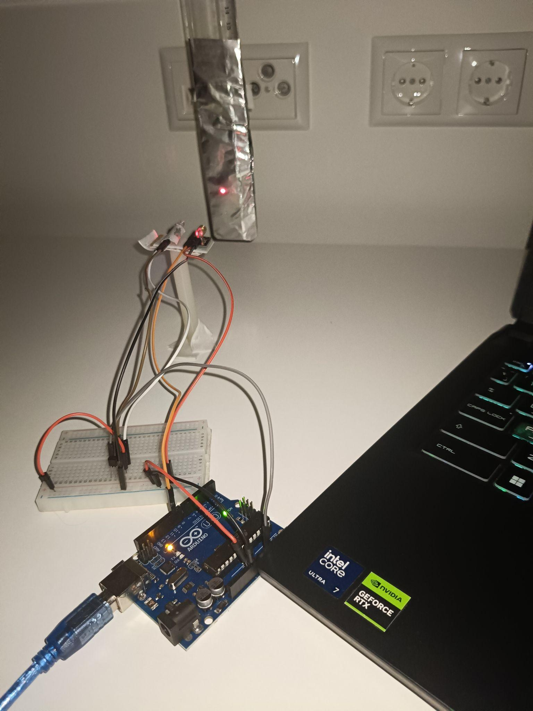
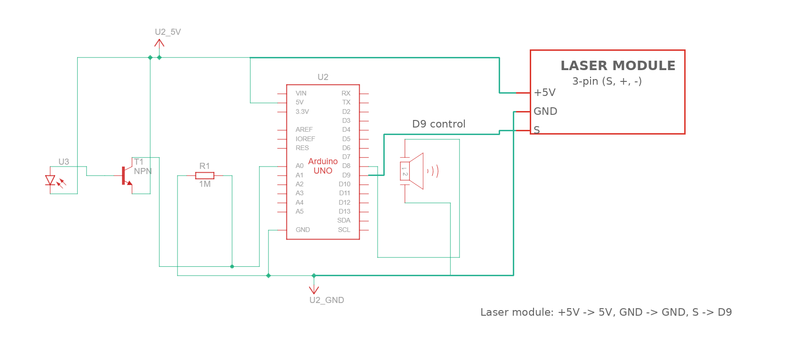
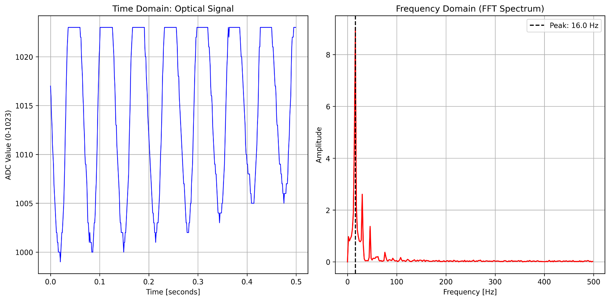
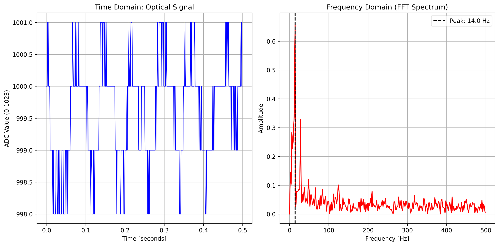
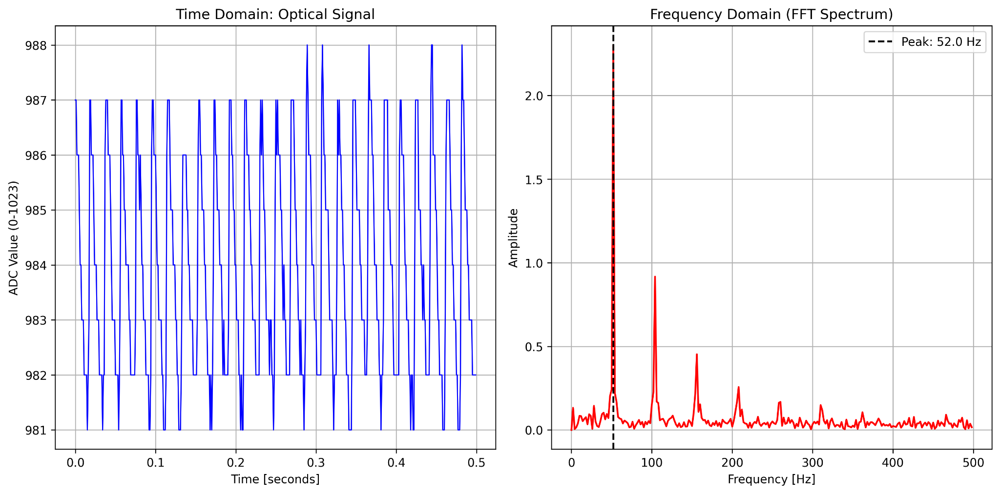
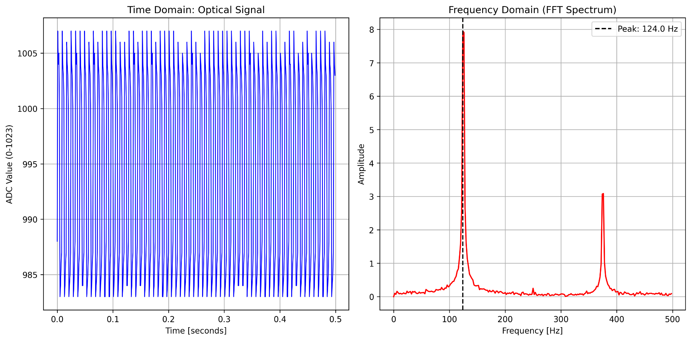
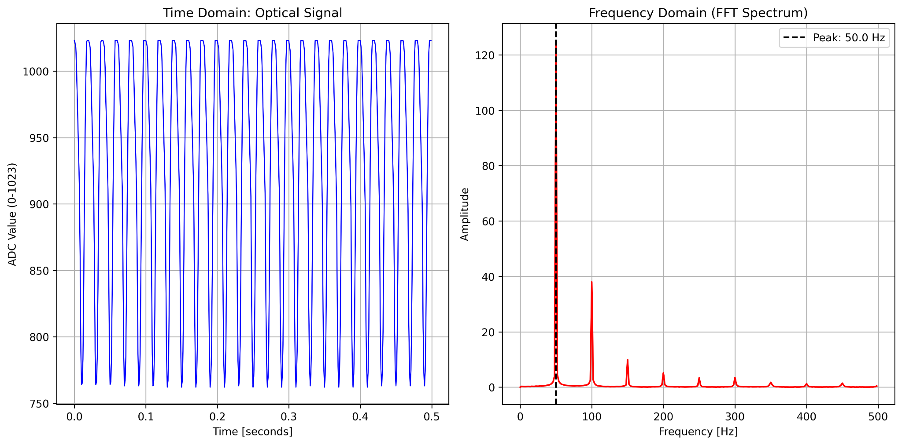
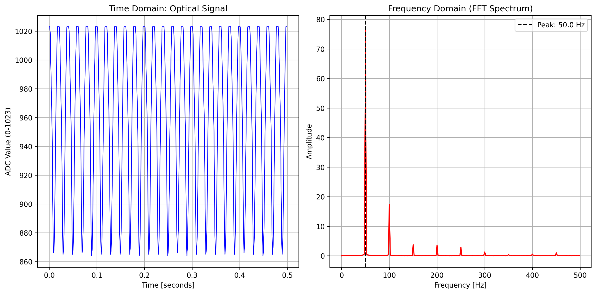

# Non-Contact Optical Vibration Sensing

A low-cost experimental system for measuring **mechanical vibration frequencies using reflected laser light**, photodetection, embedded acquisition, and FFT-based signal analysis.

The measurement chain is:

**Mechanical motion → reflected-beam variation → optical intensity variation → NPN-amplified detector signal → Arduino ADC acquisition → Python FFT → dominant vibration frequency**

📄 **[Full Technical Report](docs/Optical_Vibration_Sensing_Report.pdf)**

---

## Project Overview

A continuous laser beam is reflected from a vibrating target toward a photodetector. Small target motion changes the received optical intensity. The detector signal is amplified using an NPN transistor stage and sampled by an Arduino Uno at a nominal **1 kHz** rate.

The samples are buffered locally to keep serial communication outside the time-critical acquisition loop. Python then removes the DC component and calculates the FFT to extract dominant spectral components.



### Electrical schematic



---

## Experimental Results

| Experiment | Result |
|---|---:|
| Cantilevered ruler | **16 Hz** dominant component |
| Ruler + €2 added mass | **14 Hz** dominant component |
| DC motor | **52 Hz** dominant component |
| Piezo/buzzer validation | **124 Hz** FFT bin for a commanded 125 Hz excitation |

### Cantilevered ruler — 16 Hz

The ruler was clamped as a cantilever, displaced, and released. The reflected optical signal produced a repeatable dominant spectral component at **16 Hz**.



### Added-mass experiment — 14 Hz

Adding a €2 coin near the free end shifted the strongest measured FFT bin from **16 Hz to 14 Hz**. Because this shift is one 2 Hz FFT bin and the loaded test was noisier, this result is treated as a **qualitative added-mass experiment**, not a precision measurement of the frequency shift.



### DC motor — 52 Hz

The optical system detected a dominant component at approximately **52 Hz**, together with higher-order spectral components near 104 Hz and 156 Hz.

If the optical geometry produces exactly one modulation cycle per revolution, 52 Hz would correspond to approximately 3120 RPM. The frequency measurement itself is the directly observed result; the RPM conversion depends on the number of optical events per revolution.



### Piezo / buzzer validation

A 125 Hz excitation was used as a controlled validation case. With a 2 Hz FFT bin spacing, the nearest reported dominant bin was **124 Hz**.



---

## Key Technical Parameters

- Nominal sampling frequency: **1 kHz**
- Samples captured per acquisition: **550**
- Samples analyzed: **500**
- FFT bin spacing: **2 Hz**
- Theoretical Nyquist frequency: **500 Hz**
- ADC: **10-bit Arduino Uno ADC**
- Serial baud rate: **115200**

> The 2 Hz value is the FFT bin spacing of the chosen acquisition window, not a calibrated ±2 Hz absolute accuracy specification.

---

## Embedded Acquisition

The Arduino firmware separates data acquisition from serial transmission:

1. Receive an `s` command over Serial.
2. Perform ADC settling reads.
3. Capture and buffer 550 ADC samples at a nominal 1 ms interval.
4. Transmit the stored block only after acquisition is complete.

This avoids `Serial.println()` occupying the time-critical sampling loop.

Source: [`firmware/optical_vibration_acquisition.ino`](firmware/optical_vibration_acquisition.ino)

---

## Python FFT Analysis

The Python script:

- opens the serial connection,
- triggers the Arduino capture,
- receives 550 ADC samples,
- discards the first 50 stored samples to reduce startup transients,
- removes the DC optical level,
- computes the FFT,
- searches for the strongest spectral component above 5 Hz,
- displays the time- and frequency-domain results,
- saves a timestamped figure automatically.

Source: [`analysis/capture_and_fft.py`](analysis/capture_and_fft.py)

---

## Engineering Challenges

This project was developed as an experimental measurement system rather than only a working demo. Several real-world issues were investigated:

- **50 Hz mains-related interference**
- higher-order interference components
- small useful optical signal swing and limited ADC headroom
- nonlinear behavior / possible clipping in the transistor amplification stage
- parasitic effects from high-value detector loading experiments
- optical alignment sensitivity
- startup and settling artifacts
- serial timing disturbances

Grounded aluminum shielding significantly reduced the observed 50 Hz component in the tested configuration.

### Example interference measurements

Before shielding:



After shielding:



The exact physical origin of all higher-order interference components was not independently isolated; possible contributors include electrical pickup, lighting modulation, nonlinear transistor behavior, and clipping.

---

## Optical Alignment

The reflected laser spot was positioned near the **edge of the detector's sensitive area** instead of fully centered on it. This knife-edge arrangement converts small beam-position changes into larger received-intensity changes and improved the sensitivity of the prototype to vibration.

---

## Limitations

This project is an **experimental optical frequency-sensing demonstrator**, not a calibrated laser vibrometer.

Current limitations include:

- no absolute displacement calibration,
- limited detector signal swing and ADC headroom,
- no dedicated low-noise transimpedance amplifier,
- no analog anti-aliasing filter,
- nominal `micros()`-based sampling rather than externally calibrated hardware-timer acquisition,
- alignment and ambient-light sensitivity,
- finite FFT record length,
- motor RPM interpretation depending on optical events per revolution.

---

## Future Improvements

Potential improvements include:

- dedicated photodiode transimpedance amplifier (TIA),
- mid-supply biasing for improved ADC headroom,
- differential / split photodetection,
- analog anti-aliasing filtering,
- hardware-timer or ADC auto-trigger sampling,
- higher-resolution ADC acquisition,
- longer acquisition windows,
- Hann windowing and sub-bin peak interpolation,
- controlled optical-vs-electrical interference testing,
- calibrated displacement measurement.

---

## Installation

Install the Python dependencies:

```bash
pip install -r requirements.txt
```

Then update the serial port in:

```python
SERIAL_PORT = "COM9"
```

Run:

```bash
python analysis/capture_and_fft.py
```

Upload the Arduino firmware from:

```text
firmware/optical_vibration_acquisition.ino
```

The 125 Hz buzzer line is commented out by default. Uncomment it only when reproducing the controlled piezo/buzzer validation experiment.

---

## Repository Structure

```text
optical-vibration-sensing/
├── README.md
├── LICENSE
├── requirements.txt
├── .gitignore
├── firmware/
│   └── optical_vibration_acquisition.ino
├── analysis/
│   └── capture_and_fft.py
├── hardware/
│   ├── setup.jpg
│   └── electrical_schematic.png
├── results/
│   ├── ruler_16Hz.png
│   ├── ruler_coin_14Hz.png
│   ├── motor_52Hz.png
│   ├── piezo_124Hz.png
│   ├── interference_before.png
│   └── interference_after.png
└── docs/
    └── Optical_Vibration_Sensing_Report.pdf
```

---

## Relevance to Photonic Sensing

The project explores a general photonic sensing workflow:

**physical motion → optical modulation → photodetection → embedded acquisition → frequency-domain evaluation**

The full technical report discusses the relationship of this experimental workflow to optical sensing, structural vibration monitoring, and more advanced photonic sensing systems while clearly distinguishing the prototype from calibrated professional instrumentation.

---

## Author

**Hossam Ahmed**  
GIU Berlin  
October 2026
